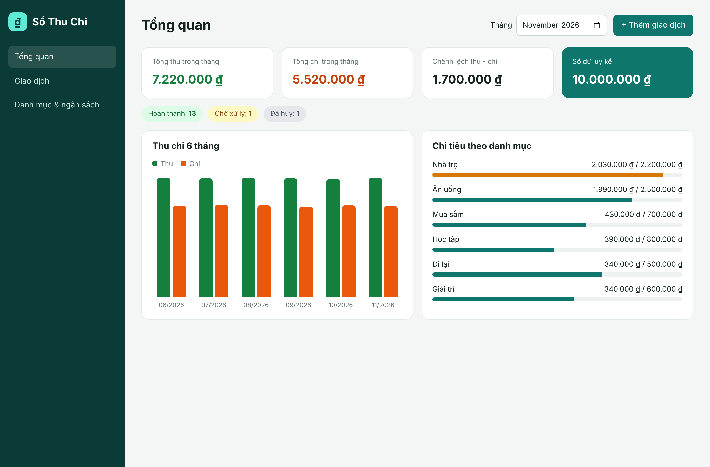
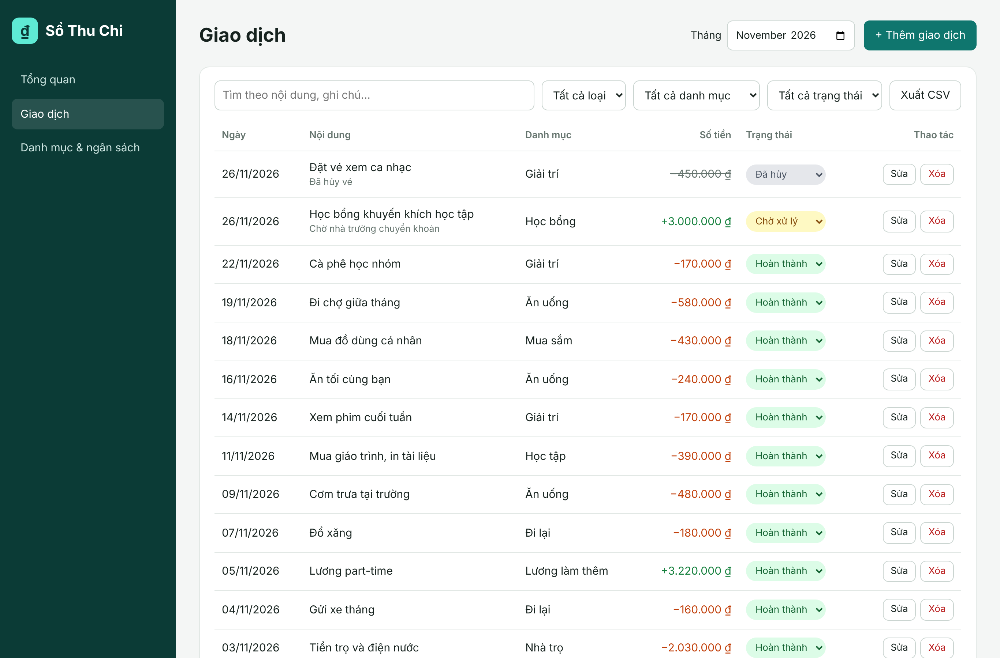
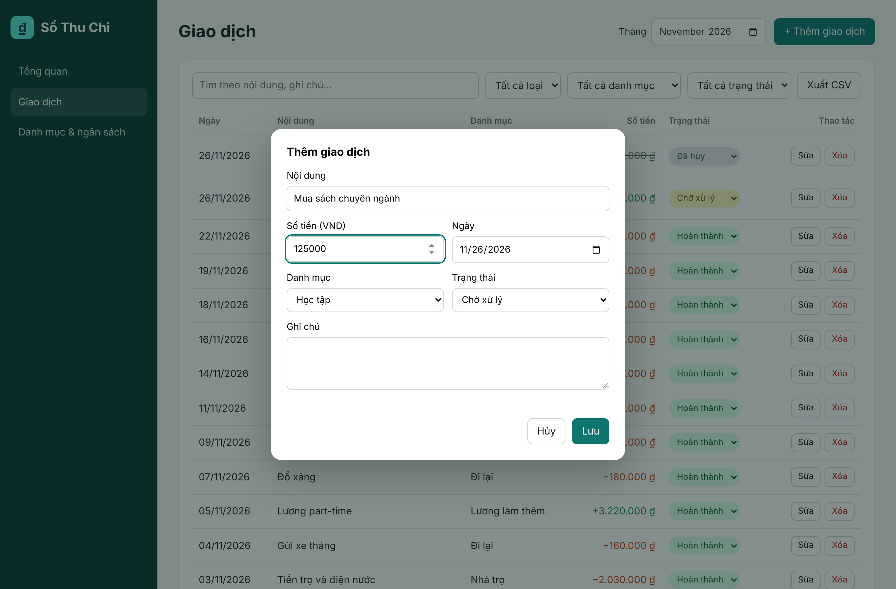
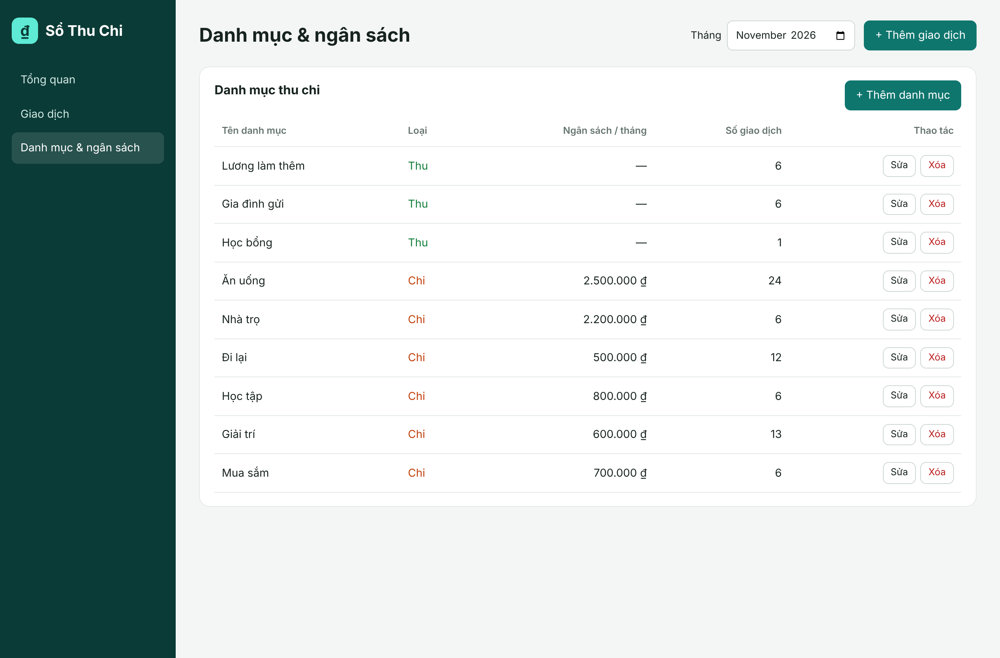
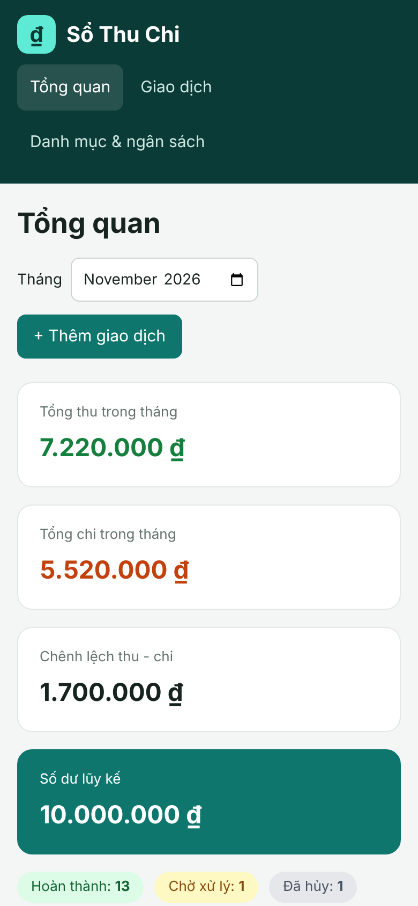

# Sổ Thu Chi - Ứng dụng web quản lý thu chi cá nhân

Công nghệ: HTML, CSS, JavaScript thuần; database IndexedDB. Không cần cài thư viện hay máy chủ.



## Chức năng
- **Quản lý thông tin:** thêm, sửa, xóa giao dịch và danh mục.
- **Cập nhật trạng thái:** Chờ xử lý, Hoàn thành, Đã hủy (đổi ngay trên bảng).
- **Thống kê:** tổng thu, tổng chi, chênh lệch, số dư lũy kế, số giao dịch theo trạng thái, biểu đồ 6 tháng, chi tiêu theo danh mục.
- **Mở rộng:** ngân sách theo danh mục và cảnh báo vượt mức, tìm kiếm và lọc, xuất CSV, giao diện tương thích điện thoại.

## Cách chạy
Mở file `index.html` bằng Chrome hoặc Edge (nhấp đúp vào file).

## Cơ sở dữ liệu
- Dữ liệu lưu trong IndexedDB của trình duyệt, được giữ lại sau khi tắt trang.
- Lần mở đầu tiên tự tạo database kèm dữ liệu mẫu 6 tháng (khai báo trong `js/db.js`).
- Xem dữ liệu: nhấn F12, chọn **Application**, **IndexedDB**, **so-thu-chi**.
- Tạo lại dữ liệu mẫu (**xóa toàn bộ dữ liệu hiện có**): F12, **Application**, **IndexedDB**, **so-thu-chi**, **Delete database**, rồi tải lại trang.
- Mỗi trình duyệt, mỗi máy có dữ liệu riêng.

## Kiểm thử
Mở `tests/test.html` bằng trình duyệt.

## Cấu trúc thư mục
```
├── index.html          # Giao diện
├── css/style.css
├── js/db.js            # Database IndexedDB và dữ liệu mẫu
├── js/store.js         # Nghiệp vụ: CRUD, trạng thái, thống kê
├── js/app.js           # Xử lý giao diện
├── tests/              # Kiểm thử
└── docs/               # Tài liệu thiết kế và hình ảnh
```

## Thiết kế và giao diện
Xem [tài liệu thiết kế](docs/thiet-ke.md) (use case, kiến trúc, ERD, trạng thái).

| Giao dịch | Thêm giao dịch |
|---|---|
|  |  |

| Danh mục và ngân sách | Điện thoại |
|---|---|
|  |  |

## Phạm vi
Ứng dụng dành cho một người dùng chưa có đăng nhập và chưa đồng bộ dữ liệu giữa các thiết bị.

## Tác giả
Nguyễn Hồng Phúc
