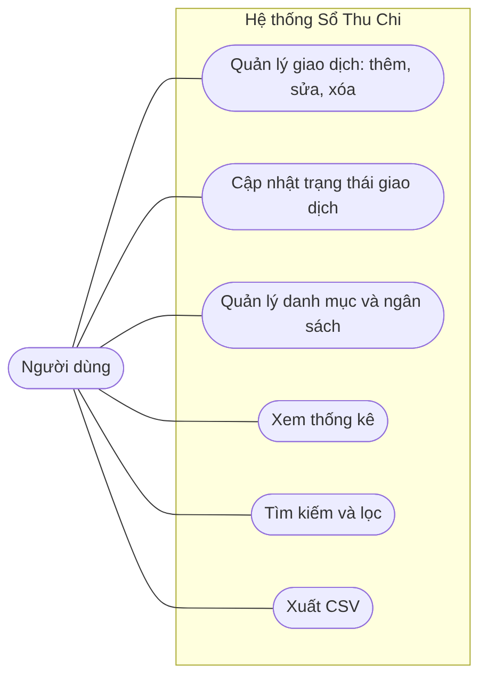
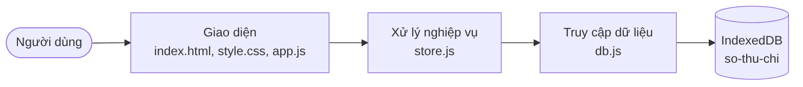
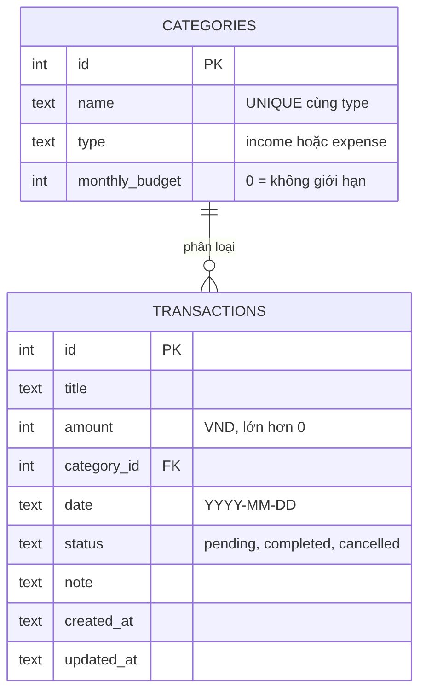
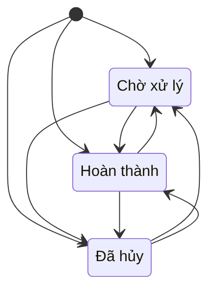

# Tài liệu thiết kế hệ thống Sổ Thu Chi

## 1. Mục tiêu
Giúp cá nhân (đặc biệt là sinh viên) ghi lại các khoản thu chi, theo dõi trạng thái và kiểm soát ngân sách hằng tháng.

## 2. Chức năng

## 3. Kiến trúc

## 4. Cơ sở dữ liệu
Database IndexedDB tên `so-thu-chi`, gồm 2 object store: `categories` và `transactions`. Khóa chính tự tăng; chỉ mục duy nhất `name_type`; chỉ mục `date`, `category_id`. IndexedDB không có khóa ngoại nên ràng buộc liên kết được kiểm tra trong `store.js`.

Một danh mục có nhiều giao dịch. Loại thu/chi được lưu ở danh mục nên giao dịch không thể lệch loại với danh mục của nó.

| Bảng | Cột | Kiểu | Ràng buộc / ý nghĩa |
|---|---|---|---|
| categories | id | number | Khóa chính |
| categories | name | string | Bắt buộc, không trùng trong cùng loại |
| categories | type | string | `income` hoặc `expense` |
| categories | monthly_budget | number | Ngân sách tháng, ≥ 0 |
| transactions | id | number | Khóa chính |
| transactions | title | string | Nội dung giao dịch |
| transactions | amount | number | Số tiền VND, > 0 |
| transactions | category_id | number | Liên kết danh mục, chặn xóa danh mục đang dùng |
| transactions | date | string | Ngày giao dịch |
| transactions | status | string | `pending`, `completed`, `cancelled` |
| transactions | note | string | Ghi chú |
| transactions | created_at, updated_at | string | Thời điểm tạo và cập nhật |

## 5. Trạng thái giao dịch
Người dùng có thể chọn trạng thái bất kỳ khi tạo và chuyển qua lại giữa các trạng thái.

## 6. Quy tắc thống kê
- Chỉ giao dịch **Hoàn thành** được tính vào thu, chi, số dư và ngân sách.
- Chênh lệch = tổng thu − tổng chi của tháng đang chọn.
- Số dư lũy kế = tổng thu − tổng chi đến hết tháng đang chọn.
- Thanh ngân sách: dưới 80% màu xanh, từ 80% đến 100% màu cam, vượt ngân sách màu đỏ.

## 7. Các hàm xử lý (store.js)
| Hàm | Chức năng |
|---|---|
| `listTransactions(filter)` | Danh sách, tìm kiếm, lọc |
| `saveTransaction(data, id)` | Thêm hoặc sửa giao dịch |
| `setStatus(id, status)` | Cập nhật trạng thái |
| `deleteTransaction(id)` | Xóa giao dịch |
| `listCategories()`, `saveCategory(data, id)`, `deleteCategory(id)` | Quản lý danh mục |
| `stats(month)` | Thống kê |
| `toCsv(rows)` | Tạo nội dung file CSV |

## 8. An toàn dữ liệu
Dữ liệu được kiểm tra trước khi ghi, mỗi thao tác ghi chạy trong một giao dịch database, nội dung hiển thị được escape để chống XSS, file CSV được xử lý để tránh chèn công thức.
